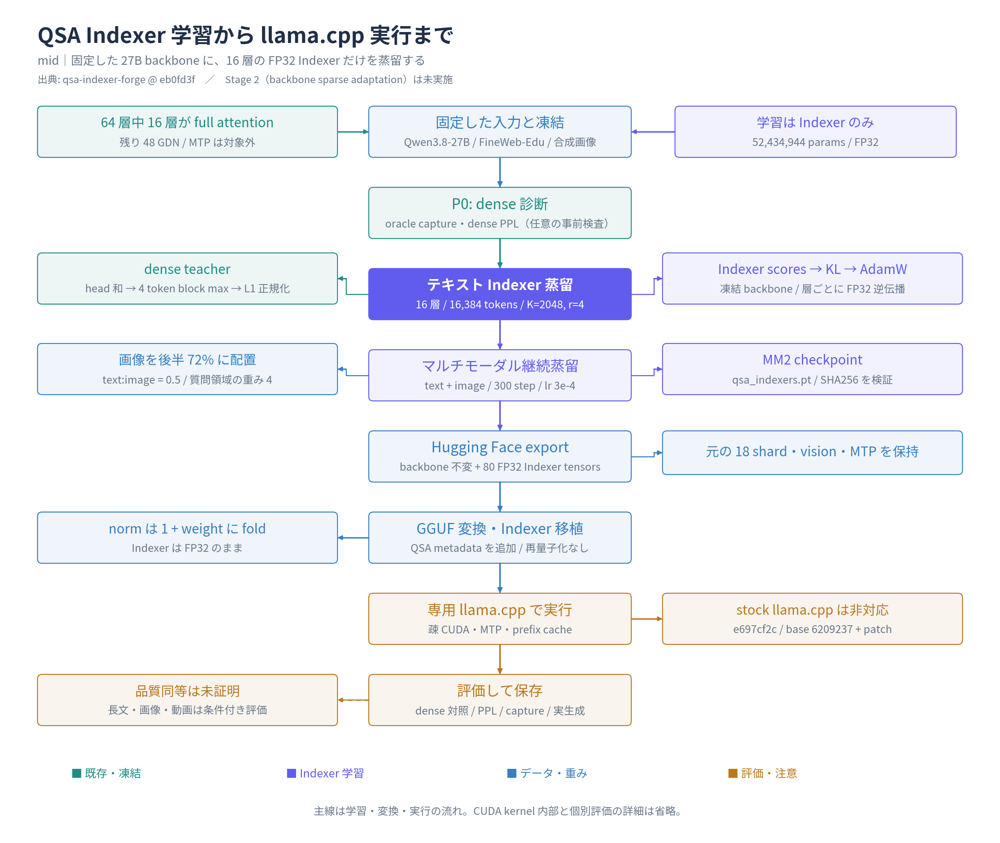
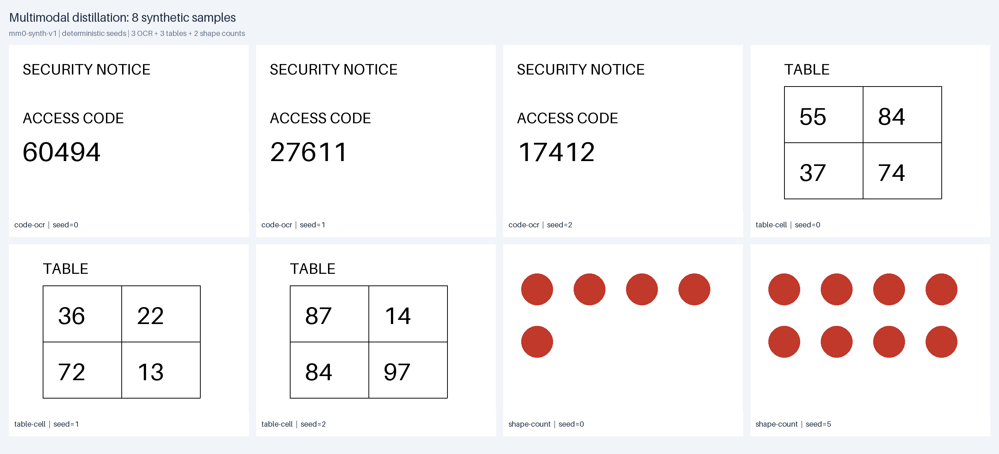

# QSA Indexer Forge

Qwen3.8-27B の 16 個の full-attention 層に、Qwen Sparse Attention (QSA) の Indexer を蒸留し、Hugging Face / GGUF / 専用 llama.cpp へ接続するための再現用リポジトリです。

原研究の別ブランチにだけ存在していた学習コード、実設定、export、GGUF への Indexer 移植、llama.cpp 差分を一つにまとめました。モデル重みやデータセットは含みません。

> [!IMPORTANT]
> これはコミュニティによる 27B への適応です。Qwen 公式 27B には最初から QSA は搭載されていません。backbone / vision / projector / MTP は凍結し、Indexer だけを学習します。論文の backbone を含む Stage 2 は未実施です。標準の llama.cpp ではこの 27B QSA GGUF を実行できません。

## 目次

- [全体図](#全体図)
- [合成マルチモーダル画像](#合成マルチモーダル画像)
- [できること](#できること)
- [ドキュメント](#ドキュメント)
- [Quick start: CPU で実装を検証](#quick-start-cpu-で実装を検証)
- [Indexer を学習する](#indexer-を学習する)
- [Hugging Face 形式へ export する](#hugging-face-形式へ-export-する)
- [GGUF / llama.cpp で実行する](#gguf--llamacpp-で実行する)
- [実測値の入口](#実測値の入口)
- [リポジトリ構成](#リポジトリ構成)
- [License](#license)

## 全体図

[](docs/assets/qsa-training-flow-mid.png)

学習する Indexer、凍結する backbone、形式変換、専用 runtime、評価の関係を示す **mid** 図です。[SVG](docs/assets/qsa-training-flow-mid.svg) / [編集用 scene](docs/assets/qsa-training-flow-mid.scene.json)。

### 合成マルチモーダル画像

実際の MM 学習コードが生成する OCR・数値表・図形カウントの 8 例です。画像内の文字や個数を追えるよう、種類と seed を併記しています。

[](docs/assets/multimodal-training-samples.png)

[各画像の seed・質問・回答・SHA256](docs/assets/multimodal-training-samples.json) / [生成スクリプト](docs/assets/build_multimodal_samples.py)。

## できること

- 教師モデルの dense attention から、4 トークン単位の block 教師分布を作る
- 16 層・52,434,944 parameters・80 tensors の FP32 Indexer を学習する
- テキストだけの蒸留と、合成画像を使ったマルチモーダル継続蒸留を実行する
- 元の BF16 shard を変更せず、学習済み Indexer を Hugging Face 形式へ追加する
- 量子化済み GGUF の backbone を再量子化せず、FP32 Indexer だけを移植する
- 検証済みの専用 llama.cpp fork、または固定 base commit への patch で実行する

## ドキュメント

詳細な読み順と全資料は **[ドキュメント目次](docs/README.md)** を参照してください。

| 文書 | 内容 |
|---|---|
| [Indexer 学習ガイド](docs/training.md) | 数式、データ、学習ループ、実行コマンド、所要時間 |
| [llama.cpp 対応ガイド](docs/llama-cpp.md) | GGUF 変換、model graph、CUDA kernel、MTP、cache、patch |
| [評価と限界](docs/evaluation.md) | PPL、capture、retrieval、DocVQA、速度、未検証事項 |
| [来歴と固定 revision](docs/provenance.md) | 元コード、公開重み、run ID、commit、SHA256 |
| [元ディレクトリの構造](docs/source-inventory.md) | 正本、関連作業場、OpenResearch の保存物、branch の対応 |
| [関連セッションの調査](docs/session-research.md) | Codex / OpenResearch / DeepSeek Harness の記録と時系列 |

## Quick start: CPU で実装を検証

Python 3.11+ と [uv](https://docs.astral.sh/uv/) を使用します。27B モデルや GPU は不要です。

```sh
git clone https://github.com/kuraneko1/qsa-indexer-forge
cd qsa-indexer-forge
uv run --locked --extra dev --extra train --extra export python -m pytest -q
```

現在の統合版では **31 tests** が CPU で通ることを確認しています。GPU 学習と native CUDA kernel の再ビルドは別工程です。

## Indexer を学習する

実測環境は Modal 上の **A100 80GB**、PyTorch 2.6.0 / CUDA 12.4、Transformers 5.22.1 です。27B BF16 を読むため、小規模 GPU へのそのままの転用は保証しません。

### 1. 新しいテキスト Indexer を作る

```sh
uv run --locked --extra train python -m qsa.p0_capture \
  --config configs/text-local.yaml
```

16,384 tokens × 600 step を実行し、100 step ごとの checkpoint、最終 `qsa_indexers.pt`、`p1_results.json` を現在の作業ディレクトリへ保存します。公開先への自動 upload は無効です。

### 2. 画像を含む入力へ継続蒸留する

直前の `qsa_indexers.pt` を初期値に使います。

```sh
uv run --locked --extra train python -m qsa.p0_capture \
  --config configs/multimodal-local.yaml
```

公開済みの最終 MM2 からさらに学習する場合は `configs/multimodal-continue-mm2.yaml` を使います。詳細と歴史的設定との違いは [学習ガイド](docs/training.md) を参照してください。

## Hugging Face 形式へ export する

元モデルと公開 Indexer を固定 revision で取得します。

```sh
uv run --locked --extra export hf download Qwen/Qwen3.8-27B \
  --revision 1d4bf0f2ff6012fd82039f2fa52739d0dd7c60c0 \
  --local-dir /path/to/base
uv run --locked --extra export hf download higa2515/Qwen3.8-27B-QSA-BF16 indexers/mm2_16k/qsa_indexers.pt \
  --revision d61281f4626729e4cf138476a704c7fedc08f891 \
  --local-dir /path/to/qsa-release

uv run --locked --extra export python -m qsa.export_model \
  --base /path/to/base \
  --indexers /path/to/qsa-release/indexers/mm2_16k/qsa_indexers.pt \
  --output /path/to/Qwen3.8-27B-QSA
uv run --locked --extra export python -m qsa.validate_export /path/to/Qwen3.8-27B-QSA
```

元の 18 個の BF16 shard、tokenizer、processor、vision、MTP を保持し、Indexer を別 shard に追加します。export 先が既に存在する場合は上書きせず失敗します。

## GGUF / llama.cpp で実行する

最も確実なのは、検証済みの専用エンジンを固定 commit で使う方法です。

```sh
git clone https://github.com/kuraneko1/Qwen3.8-27B-QSA-llama.cpp
cd Qwen3.8-27B-QSA-llama.cpp
git checkout e697cf2c72ecaa165de3714ea6ac3b00649ab274
```

変換、CUDA build、server 起動、`LLAMA_QSA_DENSE=1` による dense 対照、base commit へ当てる独立 patch は [llama.cpp 対応ガイド](docs/llama-cpp.md) にまとめています。3 つの patch は独立した版です。通常は `llama-qsa27b-mm2-cache.patch` を選び、**重ねて適用しない**でください。

## 実測値の入口

| 対象 | 実測 | 注意 |
|---|---|---|
| Text step600 | capture 0.9414、PPL 7.072960 → 7.071757 | 16k、小規模評価 |
| 最終 MM2 | capture 0.9353、PPL 7.072960 → 7.071384 | 16k・300 step、backbone 凍結 |
| Native 261,120 入力 | decode QSA 41.07 / dense 22.91 token/s | Q8_0、V100 系 2 枚、特定条件 |

これらは一般的な品質同等性や全環境での速度を証明しません。QSA は全 KV を保持する方式で、KV 保存容量の圧縮ではありません。`K=2048` は固定なので、選択率が常に 12.5% という意味でもありません。

## リポジトリ構成

```text
qsa/                  Indexer、教師分布、KL、学習、HF export/runtime
configs/              安全な local 学習設定と評価の記録
configs/historical/   実際に使われた設定の保存版（そのまま実行しない）
scripts/              GGUF への Indexer 移植と検証
patches/              llama.cpp の3段階の独立差分と MIT license
tests/                CPU unit / conversion / cache tests
docs/                 学習・native 実装・評価・来歴・調査記録
.github/workflows/    CPU test CI
```

## License

コードと文書は [Apache-2.0](LICENSE)、`patches/` は [MIT](patches/LICENSE) です。モデル、FineWeb-Edu、DocVQA など外部成果物には各々の条件があります。[NOTICE](NOTICE.md) を参照してください。
