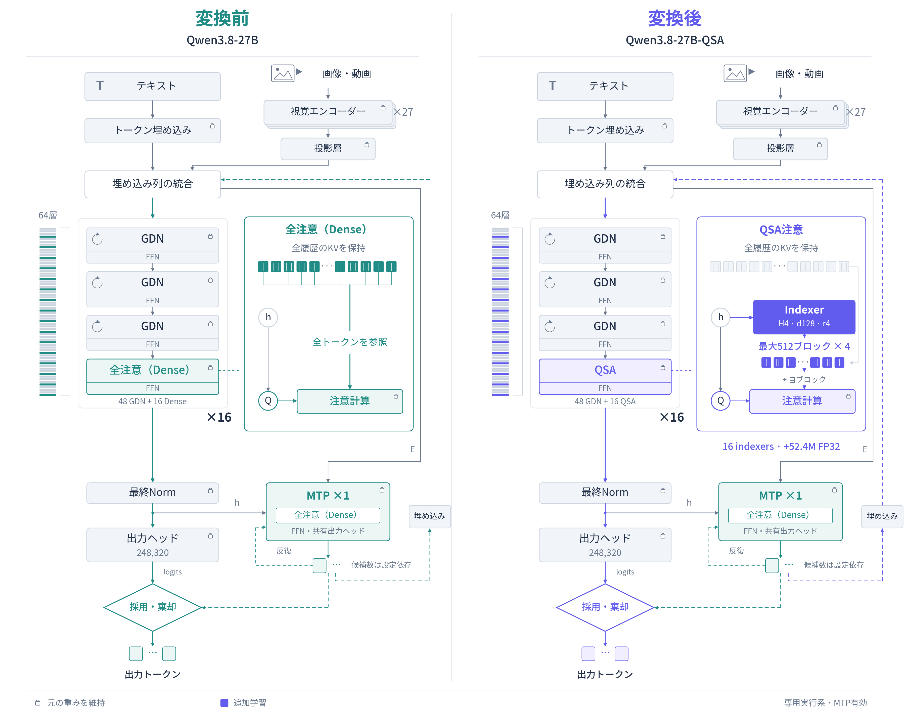

# アーキテクチャ（変換前 / 変換後）

Qwen3.8-27B に QSA の Indexer を追加する前後を、同じ層構成で左右に並べた図です。図はすべてベクターコードで描画しており、画像生成は使っていません。

| 版 | PNG | 編集用 SVG | フォント非依存 SVG | PDF |
|---|---|---|---|---|
| 日本語 | [PNG](assets/architecture/qsa-architecture-ja.png) | [SVG](assets/architecture/qsa-architecture-ja.svg) | [Outlined](assets/architecture/qsa-architecture-ja-outlined.svg) | [PDF](assets/architecture/qsa-architecture-ja.pdf) |
| English | [PNG](assets/architecture/qsa-architecture-en.png) | [SVG](assets/architecture/qsa-architecture-en.svg) | [Outlined](assets/architecture/qsa-architecture-en-outlined.svg) | [PDF](assets/architecture/qsa-architecture-en.pdf) |

PNG は 3600×2820。拡大・印刷には outlined SVG か PDF を使ってください。

## 変わるもの / 変わらないもの

| 要素 | 変換前 | 変換後 | 扱い |
|---|---|---|---|
| 層数 | 64（GDN 48 + 全注意 16） | 同じ。**層の種類も順序も不変** | 変更なし |
| 全注意層 | Q/K/V + output gate の射影 | 同じ射影 + **Indexer** | Indexer のみ追加学習 |
| Indexer | 無し | 16 層 × 5 テンソル = 80 テンソル、**52,434,944 params / FP32** | 唯一の学習対象 |
| 選択予算 | 全トークン | `K=2048` トークン（`r=4` なので 512 ブロック）+ 自ブロック | 推論時の設定 |
| KV | 全履歴を保持 | **全履歴を保持したまま** | 容量削減ではない |
| MTP | 1 層、dense | 1 層、dense のまま | Indexer を持たない |
| vision encoder / projector | 変更なし | 変更なし | 画像・動画の特徴量は共通の入力埋め込み列へ |
| 重み | BF16 | backbone / vision / MTP は BF16 のまま | lock は「再学習しない」の意 |

## 図の読み方

- 左端の 64 本の帯は 48 GDN 層と 16 全注意層の全てを表します。拡大した 4 層グループが `GDN + FFN` 3 層と `Attention + FFN` 1 層で、これが 16 回繰り返されます。
- 変換後の紫が QSA 経路です。**塗りつぶした Indexer だけが追加学習の対象**で、鍵アイコンは既存の学習済み重みを維持する部分です。
- テキストは token embedding lookup、画像・動画は vision encoder と projector を経由し、同じ入力埋め込み列へ統合されます。視覚特徴を token embedding lookup に通す意味ではありません。
- 上段の KV 列は全履歴を保持します。紫色のブロック列は**読み出し対象の選択**であり、KV を削除する操作ではありません。
- MTP へ分岐する `h` は最終 Norm 後・出力ヘッド前の hidden です。MTP は本体 64 層とは別の 1 層で、変換前後とも dense 注意です。候補数は設定依存で、図の小矩形は個数を表しません。
- この図の変換後は**専用 native 実行系**（画像・動画も QSA 経路）です。HF / Python 参照版は画像・動画要求を dense へ fallback する点が異なります。
- 量子化の違いは構造図から省略しています。lock は「元モデルを finetune していない」意味で、GGUF が元 BF16 と byte-identical という意味ではありません。

## 数値の根拠

- 対象層は 0 始まりで 3, 7, 11, …, 63 の 16 層。残り 48 層は GDN。
- Indexer は H=4 heads、head dim 128、部分 RoPE 64、ブロック圧縮 r=4。スコアは head ごとの ReLU の和、ブロック因果マスク付き。
- 元モデルは 24 query heads / 4 KV heads / head dim 256、hidden 5,120、context 262,144、MTP 1 層。
- 学習・評価の条件と限界は [Indexer 学習ガイド](training.md) と [評価と限界](evaluation.md) を参照してください。

## 来歴

- 作図: Matplotlib によるベクター描画。`docs/figures/qsa-architecture/build.py`（原研究リポジトリ）で再生成できます。
- 配布元: `qsa-architecture-ja-en.zip`（原研究リポジトリ）。
- 2026-11-05 のレビューで、最終 Norm と出力ヘッドの分離、画像特徴の統合経路、MTP 候補の戻り経路を修正済みです。
