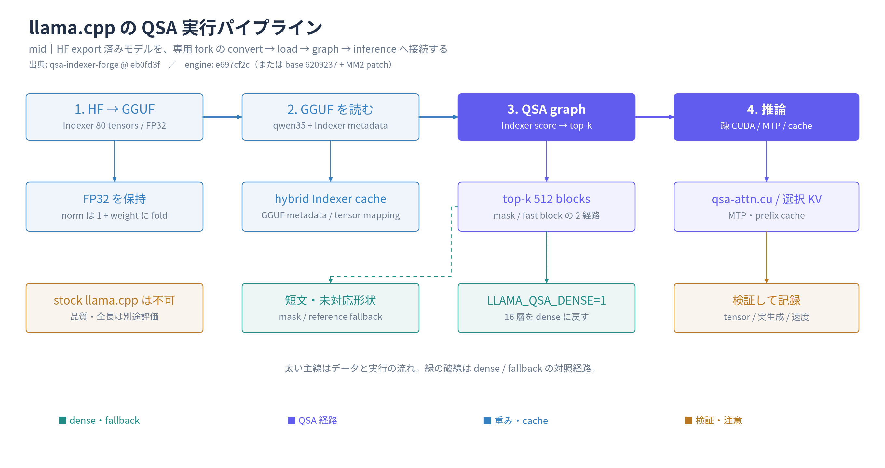

# Qwen3.8-27B-QSA を llama.cpp で動かす

対象: Qwen3.8-27B（64層 = GDN 48 + 全注意 16 + MTP 1）に、学習済み QSA indexer を追加したモデルを
llama.cpp の専用 fork で実行するための実装解説と再現手順。

- 正本リポジトリ: `/home/ryu/OpenResearch/27b-qsa`
- 公開エンジン: `kuraneko1/Qwen3.8-27B-QSA-llama.cpp`（base は `pentaCoxian/Qwen-V100-llama.cpp`）
- 固定 revision: **`e697cf2c72ecaa165de3714ea6ac3b00649ab274`**（以降の commit は README / RUNTIME / 画像のみ）

> **この文書の状態**
> 本文はリポジトリ内の実装・記録（docs/、qsa27b/、patch、engine checkout）から再構成したもので、
> 作成環境（ubuntu-desktop1729）には `/mnt/data2` も実 GGUF も無いため、**ビルド・変換・起動・測定は未実行**。
> コマンドは「記録された手順」であり、実行済みの主張ではない。実機での確認結果は各節に明記する。

> **重要**: 通常の llama.cpp ではこの QSA は動かない。indexer テンソルを読む arch 実装・疎 attention カーネル・
> 専用 server 分岐を含むこの fork が必要。HF の参照実装（Transformers）は別経路で、MTP 推論や画像 QSA は未実装。

**パスの読み方**: このリポジトリはエンジンの全ソースを同梱しない。`patches/` と本ガイドを持ち、
実体は公開エンジン repo を固定 commit で取得する。以下の `src/...`、`ggml/...`、`conversion/...`、
`qsa27b/...` は**エンジン repo 内のパス**、`qsa/...`、`scripts/...`、`docs/...` は**このリポジトリ内**。
実装の経緯と数値検証の詳細は [native runtime の記録](native-runtime-history.md) を参照。

## 図解

[](assets/llama-cpp-pipeline.png)

HF / GGUF の変換から、model load、QSA graph、疎 CUDA 推論までを示す **mid** 図です。dense / fallback 経路と検証も含みます。[SVG](assets/llama-cpp-pipeline.svg) / [編集用 scene](assets/llama-cpp-pipeline.scene.json)。

---

## 0. 用語と構成

| 用語 | 意味 |
|---|---|
| QSA | Qwen Sparse Attention。全注意層で「読む過去ブロック」を indexer が選ぶ |
| indexer | 層ごとの小さな MQA 選択器。H=4 query head、共有 key head 1、head dim 128、RoPE 64 |
| block (r) | 連続 4 トークンの非重複ブロック。key は平均 pool してから RMSNorm → 部分 RoPE |
| top_k | 選択トークン予算 2048（= 512 block）。**現在の自ブロックは常に含める** |
| dense 対照 | 同じ GGUF で `LLAMA_QSA_DENSE=1` を設定し、16 全注意層を dense に戻した実行 |

- QSA は **KV キャッシュ圧縮ではない**。全 KV を保持し、注意計算で読む範囲を減らす。
- 対象は 0 始まりで層 `3, 7, 11, …, 63` の 16 層。48 層の GDN は対象外。
- indexer は 16 層 × 5 テンソル = **80 テンソル、52,434,944 params、FP32**。
- MTP 層は indexer を持たず、注意は dense のまま（長文では全ブロックを疎カーネルで読む経路がある）。

### エンジンの 2 系統（混同しない）

| 系統 | 用途 | 実体 |
|---|---|---|
| 本流（本文書） | 27B QSA + MM2（画像・動画）+ MTP、Q8_0 / UD-Q4〜Q6 | 公開エンジン repo `e697cf2c`。3 種の patch はこのリポジトリ |
| IQ3_S 24GB 派生 | RTX 3090 24GB 単体向けの量子化・配布 | 別エンジン `pentaCoxian/Qwen-QSA-llama.cpp @70b4e14`。詳細は [provenance.md](provenance.md) |

---

## 1. convert — HF → GGUF

### 1.1 indexer を HF モデルへ統合する

`qsa/export_model.py` が、変更していない 18 shard を hardlink（不可ならコピー）し、
追加 shard `qsa-indexers.safetensors` に indexer を書く。

- テンソル名: `model.language_model.layers.{il}.self_attn._qsa_indexer.{q_proj,k_proj,q_norm,k_norm,k_block_norm}`
- `config["qsa"] = {budget:2048, block_size:4, indexer_heads:4, indexer_head_dim:128, rope_dim:64, multimodal_policy:"dense", runtime:"reference_sdpa"}`
- `architectures = ["QSAQwen3_5ForConditionalGeneration"]`、`model_type = "qwen3_5_qsa"`
- 入力の indexer checkpoint は **`Qwen3.8-27B-QSA-BF16 @ d61281f` の `indexers/mm2_16k/qsa_indexers.pt`** を使う。
  旧 `qwen38-27b-qsa-indexers` は現在 401 で取得できない（[provenance §3.1](provenance.md)）。

参照: `qsa/export_model.py:44-72`（既定値・形状と FP32 の検査・テンソル名）、`:112-130`（shard 追加と config 書き換え）。
CLI は `:184-199`:

```sh
python -m qsa.export_model --base /path/to/Qwen3.8-27B \
  --indexers /path/to/qsa_indexers.pt --output /path/to/Qwen3.8-27B-QSA \
  --provenance provenance.json
python -m qsa.validate_export /path/to/Qwen3.8-27B-QSA
```

出力先が既に存在する場合は上書きせず失敗する。

### 1.2 GGUF へ変換する

`conversion/qwen.py:888-913` の `QSAQwen35Model`（arch `QWEN35`）が担当する。

- HF の `._qsa_indexer.` を GGUF の `blk.{il}.indexer.*` へ写す。
- **norm は `+1` して保存**（zero-centered RMSNorm を通常 RMSNorm に畳む）。
  - `k_norm` → `k_norm.pre_weight`（pool 前）
  - `k_block_norm` → `k_norm.weight`（pool 後）
- **indexer は常に F32**（`tensor_force_quant`）。本体の量子化対象にしない。
- 登録: `conversion/__init__.py:242`（text）、`:345`（mmproj）。mmproj は別ファイル。

### 1.3 量子化

| 経路 | 方法 | 備考 |
|---|---|---|
| Q8_0 | converter の `--outtype q8_0` | indexer は F32 のまま。946 テンソル中 Q8_0 506 / FP32 440 |
| UD-Q4_K_M / Q5_K_M / Q6_K | **再量子化しない**。公開 GGUF に FP32 indexer 80 個を移植 | `scripts/transplant-qsa-gguf.py`。元 866 テンソルを byte-exact 保持 |
| IQ3_S | 本流の手順ではない（別系統） | `provenance.md` 参照 |

`transplant-qsa-gguf.py` は入力/出力の SHA256 を照合し、metadata・tensor 型・形状・payload を
再読込で検証してから `.partial` を rename する。元 GGUF に `.indexer.` が無いこと、
donor 側が 80 個すべて F32 であることを assert する。

### 1.4 変換の検証

`scripts/validate-qsa-gguf.py` で、80 indexer が HF の FP32 重み（norm の `+1` 込み）と一致することを確認する。
記録では全 80 テンソル完全一致（研究リポジトリ `docs/z170-deployment.md:105`）。

---

## 2. load — GGUF を読む

| 段階 | 実装 | 内容 |
|---|---|---|
| metadata | `src/models/qwen35.cpp:27-32` | `indexer.head_count` が無ければ indexer 無しとして読む（plain GGUF 互換） |
| tensors | `src/models/qwen35.cpp:83-90` | 全注意層に `index_q_proj`(5120→4×128), `index_k_proj`(5120→128), `q_norm`, `k_norm`, `k_norm.pre_weight` を生成 |
| memory | `src/llama-model.cpp:2703, 2722-2727, 2756-2760` | indexer があれば `llama_memory_hybrid_idx` を選び、`filter_idx` を dense-attn 層のみに限定 |
| 分割 | `src/llama-model.cpp:514-517` | indexer cache は MQA で分割不可 → `MIRRORED` |
| cache 整合 | `src/llama-memory-hybrid-idx.cpp:935-945` | `blk_ok()`: attn と idx の cell が揃っているか |

GGUF key / tensor 名の定義は upstream 既存で、この fork は `src/llama-arch.cpp` を変更していない
（`:289-294` が key、`:684-694` がテンソル名）。

### 2.1 GGUF tensor 一覧（全注意層 16 層ぶん）

| テンソル | 形状 | 型 |
|---|---|---|
| `blk.{il}.indexer.q_proj.weight` | 5120 × 512 | F32 |
| `blk.{il}.indexer.k_proj.weight` | 5120 × 128 | F32 |
| `blk.{il}.indexer.q_norm.weight` | 128 | F32 |
| `blk.{il}.indexer.k_norm.pre_weight` | 128 | F32 |
| `blk.{il}.indexer.k_norm.weight` | 128 | F32 |

`il ∈ {3,7,11,…,63}`。`pre_weight` は pool 前、`k_norm.weight` は pool 後。

### 2.2 GGUF metadata

| key | 値 | 意味 |
|---|---|---|
| `general.architecture` | `qwen35` | 27B の arch |
| `qwen35.attention.indexer.head_count` | 4 | indexer query head 数 |
| `qwen35.attention.indexer.key_length` | 128 | indexer head dim |
| `qwen35.attention.indexer.top_k` | 2048 | 選択トークン予算 |
| `qwen35.attention.compress_ratios` | 層配列（full-attention のみ 4、他 0） | block size と対象層を兼ねる |

- block size は実装上 **r=4 固定**（`qsa-attn-kernels.cuh:8-11` の `QSA_ATTN_R`）。
- `indexer.block_size` という key も gguf-py には存在するが、27B の変換は `compress_ratios` を使う。

### 2.3 モデル側の前提

- 本体: Q8_0（498）+ FP32（353）、MTP: Q8_0（8）+ FP32（7）、indexer: F32（80）＝ 946 テンソル。
- mmproj は別 GGUF（F16）。本 GGUF に内包しない。
- MTP は `nextn_predict_layers=1`。GGUF に MTP テンソルが含まれる（15 個）。

---

## 3. graph — 計算グラフ

### 3.1 入口（27B）

`src/models/qwen35.cpp:338-357`:

```
if (indexer_head_size > 0 && cparams.qsa_enabled && !getenv("LLAMA_QSA_DENSE")) {
    cached = hybrid->get_blk() && (blk_ok() || ...);
    fast   = cached && qsa_block_fast(hybrid, ratio);
    if (fast) { top_blocks = build_qsa_blk_select(...); }       // 疎カーネル経路
    else      { self_kq_mask_cnv = build_qsa_mask(...); ... }   // mask 経路
}
if (top_blocks) cur = build_attn_qsa_blk(...);
else            cur = build_attn(...);
```

### 3.2 mask 経路（短文・参照実装）

`src/models/qwen35.cpp:839-911`。graph 上で以下を組む。

1. 生 key を indexer cache に書く（`cpy_k`）。
2. r=4 平均 pool → RMSNorm → ブロック位置で mRoPE。
3. query を norm → mRoPE。
4. `ReLU(q·k)` を head 方向に和、`1/sqrt(d)` スケール、可視 bias（未来ブロックは -inf）。
5. `ggml_top_k` で 512 ブロック、自ブロックを強制 ON。
6. causal mask と合成し、`[n_kv, n_tokens]` のマスクとして通常 attention に渡す。

**短い入力の扱い**: `n_kv <= top_k` のときは素の causal mask を返す（`:868`）。
つまり indexer top_k より短い prompt は dense と同一経路になり、QSA の効果も差も出ない。

### 3.3 fast 経路（疎カーネル）

- gate: `src/models/qwen4exp.cpp:1130-1152`。flash attention・causal・単一 stream・`blk_ok()`、
  かつ `(cell0+1)/r >= top_k/r + 1`（= top_k を超える履歴がある）こと。
- 選択: `src/models/qwen4exp.cpp:1419-1527`。64MB 予算で token chunk に分割し、
  `ReLU` head 和 → 可視 bias → `top_k` → chunk を連結。
- attention: `src/models/qwen4exp.cpp:1833-1944`。K/V cache の view と selected mask、block id を
  `GGML_OP_FLASH_ATTN_EXT` の **`src[5] = ids`** として組む（`:1932-1937`）。
- 27B 固有: `n_tok > 16` かつ `n_kv <= LLAMA_QSA27B_MASKED_PREFILL_MAX`（既定 65536）では
  mask を展開する MHA 経路を使う（`:1870-1891`）。長文 prefill は疎カーネルへ。

### 3.4 graph 再利用と cache

- `llm_graph_input_qsa_blk` は ubatch ごとに「触れたブロック」だけ再 pool する。
- レイアウトが崩れた場合（token が次の cell 以外に置かれた等）は pooled cache を無効化し、
  dense 経路へフォールバックする（`llama-memory-hybrid-idx.cpp:892-929`）。
- 環境変数: `LLAMA_QSA_RESERVE_BLK`（reserve graph を疎経路で確保）、`LLAMA_QSA_BLK_REBUILD`、
  `LLAMA_QSA_BLK_DEBUG`、`LLAMA_QSA_CHUNK_TOKENS`、`LLAMA_QSA_CHUNK_FIXCOUNT`、
  `LLAMA_QSA27B_REFERENCE`（mask 経路を強制）。

---

## 4. inference — カーネルと実行

### 4.1 疎 CUDA カーネル

- dispatch: `ggml/src/ggml-cuda/fattn.cu:722, 761-782`。`src[5]` が I32 なら QSA 経路。
- 実装: `ggml/src/ggml-cuda/qsa-attn.cu`
  - 対応判定 `:21-46`: q=F32、K/V=Q8_0 または F16（両方同じ型）、D=256、R=4、GQA ∈ {24,16,12,8,6,4,3,2,1}。
  - 起動 `:48-141`: 1 CTA = (split, kv head, token)。SM 数から `n_split ≤ 64` を決め、
    split ごとの部分和を最後に合成。GQA ごとに warp 内の head 配置を変える。
  - デバイスコード: `qsa-attn-kernels.cuh`。Q8_0 は lane ごとに 8 dim を dequant、
    F16 はそのまま読む。opt-in で int8 dot（`GGML_CUDA_QSA_DP4A=1`）、head 配置 `GGML_CUDA_QSA_HPW6=1`。
- **CUDA のみ**。CPU / 他 backend には疎カーネルが無く、mask 経路または gather + 通常 attention に
  フォールバックする（性能は未評価）。

### 4.2 MTP（投機デコード）

- 通常 MTP は `--spec-type draft-mtp` で有効。MTP 層の注意は dense のまま。
- 画像入力: `common/speculative.cpp:1814-1856` が視覚 embedding E と本体 hidden H を別入力として渡し、
  MTP 側 KV も更新する（従来は画像で skip していた）。
- checkpoint: `:2371+` の `get_state/set_state` が `pending_h` を保存・復元。
  新規会話では carry を reset。
- 27B 対応: `src/llama-context.cpp:1470-1483`（`mtp_kv_only` を QWEN35 へ拡張、入力埋め込みの差し替え）、
  `src/llama-graph.cpp:106-131`（ubatch の元 row を選ぶ）。
- `LLAMA_MTP_LAG` / `LLAMA_MTP_ASYNC` は **0 固定**。checkpoint 復元後の catch-up 欠落が記録されている。

### 4.3 cache

- 1 スロット内の会話・共通 prefix を再利用。対象は本体 KV、indexer pooled key、MTP carry、checkpoint。
- 画像の同一性は媒体 hash で照合する。別画像に古い KV を流用しない。
- サーバー再起動を越えるディスク永続 cache ではない。
- 起動例では `--cache-ram 0 --ctx-checkpoints 8 --checkpoint-min-step 1024 --no-context-shift`。

### 4.4 server

`tools/server/server-context.cpp:1809-1822`:

- GGUF の `indexer.head_count` を見て QSA27B と判定し、`n_parallel != 1` ならエラー。
- `LLAMA_QSA_DENSE` の有無で sparse / dense を決め、モードが変わったら KV・indexer・MTP cache を全消去。
- 起動ログに `QSA27B route: sparse text | sparse multimodal | dense baseline` を出す。

---

## 5. patch の 3 段階（重ね適用禁止）

| # | patch | files | 差分 | 内容 |
|---|---|---:|---|---|
| 1 | `patches/llama-qsa27b.patch` | 14 | +196/−5 | 初期 mask 参照版 |
| 2 | `patches/llama-qsa27b-sparse.patch` | 17 | +488/−73 | 疎カーネル版（MTP 画像/cache なし） |
| 3 | `patches/llama-qsa27b-mm2-cache.patch` | 22 | +605/−76 | **公開版の全差分**（MM2 + MTP + cache） |

- いずれも base **`6209237`** に**単独**で適用する。旧版と重ねない。
- SHA256 は `provenance.md` の表を参照。
- 3 は `e697cf2c` のコード部分（README / qsa27b/ / validation を除く 22 ファイル）と一致する。
- 公開用の最小構成は **3 のコード差分（conversion を含む）+ 公開 engine の `qsa27b/{build.sh,launch-captured-runtime.sh}`**。
  1・2 は履歴であり、公開実績のあるランタイムとは一致しない。

---

## 6. 使い方 A — 公開 engine commit を使う

```sh
git clone https://github.com/kuraneko1/Qwen3.8-27B-QSA-llama.cpp
cd Qwen3.8-27B-QSA-llama.cpp
git checkout e697cf2c72ecaa165de3714ea6ac3b00649ab274
```

この revision の `qsa27b/` にビルド・起動・検証の一式が入っている。
既定ブランチ `codex/qsa27b-mm2` の tip は `24406308` だが、差分は README / RUNTIME のみ。

## 7. 使い方 B — base に patch を当てる

```sh
git clone https://github.com/pentaCoxian/Qwen-V100-llama.cpp
cd Qwen-V100-llama.cpp
git checkout 6209237df53569f07429f3f79fc5354de5fe704f
git apply --check /path/to/patches/llama-qsa27b-mm2-cache.patch
git apply /path/to/patches/llama-qsa27b-mm2-cache.patch
```

適用後に `git diff --stat` が 22 files / +605/−76 程度になることを確認する。
（この公開リポジトリでは clean base archive への `git apply --check` 済み。実適用後の CUDA ビルドと 27B 推論は未実行。）

## 8. CUDA ビルド

`qsa27b/build.sh:6-17` の設定:

```sh
CUDA_HOME=/usr/local/cuda-12.9 bash qsa27b/build.sh
# cmake -DGGML_CUDA=ON -DCMAKE_CUDA_ARCHITECTURES=70 \
#   -DGGML_CUDA_FA=ON -DGGML_CUDA_FA_ALL_QUANTS=OFF \
#   -DGGML_CUDA_FA_QUANTS=q4_0-q4_0;q8_0-q8_0;f16-f16;bf16-bf16 \
#   -DGGML_CUDA_GRAPHS=ON -DGGML_CUDA_NCCL=ON -DLLAMA_BUILD_TESTS=OFF ...
```

- 公開 runtime archive は **sm70** ビルド。他の GPU は自前ビルドが必要（`qsa27b/RUNTIME.md`）。
- `CMAKE_CUDA_COMPILER` を省くと nvcc を見つけられない環境がある（`docs/z170-deployment.md` 系の記録）。
- `CMAKE_CUDA_ARCHITECTURES` は `QSA_CUDA_ARCH` で上書きできる。

## 9. 起動

`qsa27b/launch-captured-runtime.sh:8-36` の要点:

```sh
export LD_LIBRARY_PATH="$PWD/bin:$PWD/lib:/usr/local/cuda-12.9/lib64"
export LLAMA_QSA_RESERVE_BLK=1 LLAMA_QSA_BLK_REBUILD=1
export LLAMA_QSA27B_MASKED_PREFILL_MAX=8192
export LLAMA_MTP_KV_ONLY=1 LLAMA_MTP_PAD=4 LLAMA_MTP_N_UBATCH=64
export LLAMA_MTP_LAG=0 LLAMA_MTP_ASYNC=0
export LLAMA_REUSE_OUT_ORDER=1 LLAMA_KV_PAD_GEO=2 LLAMA_CKPT_TAIL_UBATCH=1
export GGML_CUDA_GRAPH_OPT=1 GGML_FT_GRAPH_CACHE=1 CUDA_SCALE_LAUNCH_QUEUES=4x

./bin/llama-server -m Qwen3.8-27B-QSA-Q8_0.gguf \
  --mmproj mmproj-Qwen3.8-27B-QSA-F16.gguf \
  --alias qwen3.8-27b-qsa -ngl all --device CUDA0,CUDA1 -sm layer -ts 1,1 \
  -fa on -np 1 --fit off -t 8 -tb 16 \
  -c 262144 -b 2048 -ub 512 -ctk f16 -ctv f16 \
  --cache-ram 0 --ctx-checkpoints 8 --checkpoint-min-step 1024 --no-context-shift \
  --spec-type draft-mtp --spec-draft-n-max 2 --spec-draft-p-min 0 \
  --spec-draft-sampling probabilistic --host 127.0.0.1 --port 8091 --jinja
```

- `-fa on`、`-np 1`、単一 stream は fast 経路の前提。
- 層分割は `-sm layer`。-ngl all で全層 GPU。
- KV は f16（Q8_0 KV を使う実験設定もある。精度条件を揃えて比較する）。
- GPU 選択は `CUDA_VISIBLE_DEVICES`。**`CUDA_DEVICE_ORDER=PCI_BUS_ID` を必ず併用**（既定の FASTEST_FIRST で番号がずれる）。

## 10. dense 対照

同じ GGUF・同じフラグで環境変数だけ変える。

```sh
LLAMA_QSA_DENSE=1 ./launch.sh    # 16 全注意層を dense に戻す
```

- 起動ログ / リクエストごとの `QSA27B route: dense baseline` を確認する。
- モード切替時に cache が消えるため、比較は起動から揃える。
- 出力の一致は保証されない（浮動小数点の順序・投機の受理で変わる）。同一出力を前提にした比較をしない。

## 11. 検証

| 対象 | 手段 | 期待 |
|---|---|---|
| GGUF の indexer | `scripts/validate-qsa-gguf.py` | 80 テンソルが HF FP32（+1 込み）と一致 |
| 移植 GGUF | `scripts/transplant-qsa-gguf.py` の validation.json | 元 866 テンソル byte-exact、80 F32、metadata 保持 |
| 数値 parity | 公開 engine の `qsa27b/validation/llama-qsa-fixture.cpp`（fixture 生成器は研究 repo 側） | 小型モデルで HF と argmax 一致 |
| MTP | 公開 engine の `qsa27b/validation/check-mm2-mtp.cpp` | kv-only の次 logits 差 0、query projection 未評価 |
| M-RoPE | 公開 engine の `qsa27b/validation/check-mm2-mrope.cpp` + `.py` | 画像位置と checkpoint 復元の一致 |
| runtime | 公開 engine の検証工具と server の `/health` / 実生成 | 短文生成・画像・SSE |
| 速度 | 研究 repo の `scripts/bench-native-qsa.py`、`bench-text-speed.py`（本 repo 未同梱） | prefill/decode、MTP 受理率 |

記録されている数値（実行済み・出典は docs/）:

- native vs HF: argmax 29/29、最大 logit 差 6.5e-4（小型 M-RoPE fixture）。
- Q8: 80 indexer 完全一致、残り 866 テンソルは旧 Q8 と byte 同一。
- 速度: 0k〜261,120 入力で decode 低下 QSA 16.66% / dense 54.06%（最長点で 1.79 倍）。

## 12. 既知の制限・未検証

- **品質**: BF16 との同条件対照が無い。64k の実文章で QSA の PPL は +1.7〜2.4%、capture 73.8%（oracle 82.9%）。
  「dense と同等」は未証明。
- **長文**: 262,144 を実際に埋めた試験は未実施（最大は約 261,120、テキスト）。262k のマルチモーダル品質は未確立。
- **画像・動画**: 限定 probe（色・OCR・表・短い動画）のみ。広い品質・128k/262k は未評価。
- **速度**: 「長文でもほぼ一定」は未達。indexer の全ブロック走査・MTP の dense 注意・host 側 mask 生成は context 依存。
- **決定性**: 同点ブロックの選択順は実装依存。bitwise 一致を保証しない。
- **MTP**: lag/async は復元不整合のため無効。MTP 用 indexer は学習していない（dense のまま）。
- **backend**: 疎カーネルは CUDA のみ。CPU・Vulkan 等はフォールバックで、性能・精度は未評価。
- **本数値の適用範囲**: 別 GPU・別 CUDA・別量子化へそのまま一般化しない。

## 13. トラブルシュート

| 症状 | 確認 |
|---|---|
| 期待より遅い / dense と同じ | `QSA27B route` ログ、`n_kv > top_k` か、`-fa on` か、`LLAMA_QSA_DENSE` が残っていないか |
| 極端に VRAM を食う | mask 経路の reserve（`LLAMA_QSA_RESERVE_BLK`）、context、KV 型、層分割 |
| 出力が毎回違う | temperature/seed、MTP 受理率、cache の有無を揃える |
| 画像で結果が変 | 媒体 hash、cache 全消去のタイミング、mmproj の指定 |
| GPU 取り違え | `CUDA_DEVICE_ORDER=PCI_BUS_ID` と `CUDA_VISIBLE_DEVICES` の同時指定 |

---

## 参照

このリポジトリ内:

- [来歴と固定 revision](provenance.md) — commit、SHA256、学習 run、IQ3_S 派生との区別
- [元ディレクトリの構造](source-inventory.md) — 正本・作業場・branch の対応
- [native runtime の記録](native-runtime-history.md) — 移植の経緯、数値検証、速度測定
- [Indexer 学習ガイド](training.md) — 教師分布、KL、学習ループ
- [README](../README.md) — CPU テスト、export、全体像

公開エンジン repo（`e697cf2c`）内:

- `qsa27b/RUNTIME.md` — 配布 runtime の起動・再ビルド・変換
- `qsa27b/build.sh` — CMake 設定
- `qsa27b/launch-captured-runtime.sh` — 起動フラグと環境変数
- `qsa27b/validation/` — fixture と検証プログラム

研究リポジトリ `/home/ryu/OpenResearch/27b-qsa` 内（このリポジトリには含まない）:

- `docs/z170-deployment.md`, `docs/mm2-native-cache-port.md` — 配備・MM2 移植の一次記録
- `docs/hf-architecture-ja.md` — モデル構造とテンソル数
- `docs/q4-indexer-audit-3090.md`, `docs/q56-indexer-audit.md` — capture / PPL 監査
