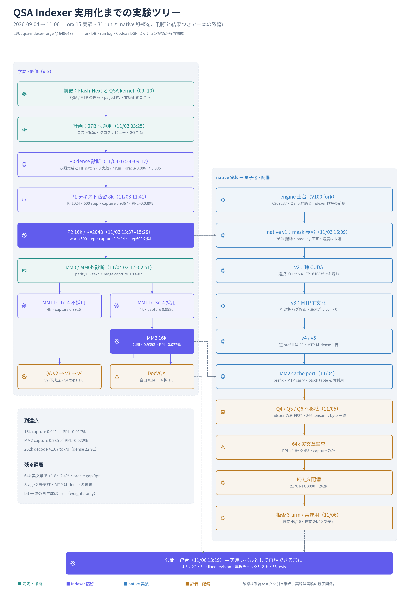

# OpenResearch における 27B-QSA 研究の記録

この文書は、Qwen3.8-27B に QSA（Qwen Sparse Attention）の Indexer を適応した研究が、
OpenResearch（orx）上でどのようなセッション・実験・run の単位で進められたかを再構成したものです。
学習そのものの数式・実装・再実行手順は [Indexer 学習](training.md)、llama.cpp 側は
[llama.cpp 対応](llama-cpp.md)、評価の解釈は [評価と限界](evaluation.md) を参照してください。
Codex / DeepSeek Harness との突き合わせは [関連セッションの網羅調査](session-research.md) にあります。

- 対象期間: 2026-11-02 〜 2026-11-06（日本時間）
- 対象プロジェクト: `ac365d39-77db-49d0-a42b-8be7ecd27278`（27B-QSA）
- 周辺プロジェクト: `9433bc86-5b71-44c8-a0dd-e9c1cb0f5a7e`（27B-QSA-Quant、量子化ナレッジベース）
- 記録の正本: OpenResearch の SQLite DB と run log。本書は**読み取り専任の調査**に基づきます
- 認証情報、プロンプト本文、無関係な私的成果物は載せていません

> 数値はすべて「その時点の記録」です。GPU・量子化・KV 型・MTP・context の条件が違う表を
> 混ぜていません。条件のない速度値を一般化しないでください。

---

## 1. OpenResearch の記録構造

OpenResearch は「プロジェクト → 実験 → run」と「チャットセッション」を別々に持ちます。
研究の再現には、この 2 系統を突き合わせる必要があります。

| 層 | 実体 | 何が分かるか |
|---|---|---|
| project | `local_projects` | リポジトリの場所、既定 branch |
| experiment | `local_experiments` | 実験の親子関係、branch 名、run command |
| run | `runs` | 実際のコマンド、commit、status、exit code、結果要約 |
| chat session | `chat_sessions` / `chat_messages` | 会話の文脈、判断の理由、失敗の会話 |
| run log | `run-logs/<run-id>.log` | TRAIN / RESULT 行、wall time、評価 |

実験は木構造です。親 experiment を凍結し、子 experiment で条件を 1 つだけ変える運用でした。
run は experiment の branch と commit を固定して実行され、`runs.commit_sha` に残ります。

用語:

- **indexer**: 各 full-attention 層で、読むブロックを選ぶ小さな注意モジュール。
- **capture**: dense の注意質量のうち、indexer が選んだブロックに入った割合。
- **oracle**: 同じ予算で注意質量を最大化した上限。
- **P0 / P1 / P2 / MM0 / MM1 / MM2**: 実験系列の識別子。論文の Stage 番号とは別。

---

## 2. セッション一覧（全 7 件）

27B-QSA プロジェクトの 6 セッションと、Quant プロジェクトの 1 セッションです。
`native session id` は OpenResearch の下で動く ACP ハーネス側の識別子です。

| chat session id | native session id | 役割 | msgs | 期間（JST） |
|---|---|---|---:|---|
| `chat_76f1417a-7b3e-471d-8d05-6d9abec84c4f` | `7a56c632-6269-4995-a7af-69a65d67495c` | 本流。P0→P2、MM0→DocVQA、text speed | 64 | 11-03 07:25 〜 11-04 08:23 |
| `chat_b3d4c01a-dc62-4e35-830b-3b3b9e55661a` | `e8e0a665-59b5-4846-9f30-c6de47157bad` | Q8 の作り直し、画像キャッシュ、起動スクリプト | 24 | 11-04 08:24 〜 10:00 |
| `chat_03b9dcea-1def-4dbd-98c9-680cd46acca7` | `0ea43929-36bd-45bf-9d8e-00563d608eff` | サイドチャット。全体像、Modal ログ、費用判断 | 6 | 11-03 09:39 〜 09:53 |
| `chat_413f5755-918e-48a6-a6d4-a76b32d36e0c` | `532ae120-e39a-46ae-a69a-81c77ec08877` | サイドチャット。進捗確認 | 2 | 11-03 11:57 |
| `chat_58a27ab3-3f36-4158-bf25-ae8fdde58422` | `d9975041-150d-4234-9283-60918c56ae43` | MM Indexer の handoff 受け取り、MM0 開始 | 2 | 11-04 01:54 |
| `chat_4f6b3c4b-cc25-4ffc-9421-a3b2d10ff651` | `7519335f-b8f7-42d8-a832-b79e13dec94c` | サイドチャット。計画の平易な説明 | 2 | 11-04 02:10 |
| `chat_5f3c5a84-ad9c-45cc-b4c6-be84279b965b` | `eb519967-6970-4ab0-acff-60ef44ebf891` | Quant。量子化ナレッジベース（別プロジェクト） | 7 | 11-04 05:26 〜 06:01 |

補足:

- サイドチャットは本体の判断を傍証する記録であり、独立した実験ではありません。
- セッションの本文は `chat_messages.parts_json` に、run の実体は `runs` と run log にあります。
- 27B-QSA の 6 セッションはすべて同じ ACP ハーネス（DeepSeek Harness）上で実行されています。

---

## 3. 実験ツリー（15 実験）

orx の 15 実験を、前史・テキスト蒸留・マルチモーダル・評価・native 移植・量子化・配備まで
1 本の系譜として並べた図です（[SVG](assets/qsa-experiment-tree.svg) / [編集用 scene](assets/qsa-experiment-tree.scene.json)）。
以下の表は orx 側の実験だけを、親子関係と run 数で示します。

`local_experiments` の 15 件です。`runs` は実行回数（失敗・cancel を含む）。

| experiment id | slug | 親 | branch / commit | runs | 位置づけ |
|---|---|---|---|---:|---|
| `d1abbdc9-ef48-4e55-b69a-1f4f634497d0` | p0-dense-baseline-oracle-capture | — | `orx/p0-dense-baseline-oracle-capture` | 0 | P0 の初版。run なし |
| `5c2692c7-8928-4cb0-a585-b58ba9c3f880` | p0-dense-baseline-oracle-capture-2 | — | `orx/p0-dense-baseline-oracle-capture-2` | 2 | P0 の再試行。依存で失敗 |
| `835519ed-7b56-404d-b698-59b04f6f5161` | p0-dense-baseline-oracle-capture-3 | 5c2692c7 | `orx/p0-dense-baseline-oracle-capture-3` | 5 | P0 成功（capture の上限） |
| `f01c5fa7-9942-4213-8fc1-662d9ff7b4ba` | p1-indexer-distillation-k-2048-r-4 | 835519ed | `orx/p1-indexer-distillation-k-2048-r-4` | 6 | P1。8k / K=1024 / 600 step |
| `08516fd9-91ad-478b-8736-58d0956ff673` | p2-16k-k-2048-retrieval-hf-persistence | f01c5fa7 | `orx/p2-16k-k-2048-retrieval-hf-persistence` @ `be2face` | 4 | P2。step100 から 500 step、step600 を保存 |
| `800a9f50-4e26-4106-8c4c-a879c0f94617` | mm0-frozen-step600-multimodal-diagnosis | 08516fd9 | `orx/mm0-frozen-step600-multimodal-diagnosis` | 0 | MM0 の並行枝。run なし |
| `b95daf6c-95dd-480f-b903-979b8c8254cb` | mm0-frozen-step600-indexer-mm-diagnosis | 08516fd9 | `orx/mm0-frozen-step600-indexer-mm-diagnosis` @ `6365577` | 1 | MM0 本番。parity と capture |
| `d41c0089-de19-47fe-9650-ec12c1aaf575` | mm0b-late-image-question-region-capture | b95daf6c | `orx/mm0b-late-image-question-region-capture` @ `dc0df50` | 1 | MM0b。画像を後置し capture を分解 |
| `71323a31-1a58-42a7-97ee-c8087f6fff23` | mm1-lr-1e-4 | d41c0089 | `orx/mm1-lr-1e-4` @ `7736ffd` | 3 | MM1。4k / 300 step / lr 1e-4 |
| `46f75a1d-cca4-4a09-8c93-f064e872f1c5` | mm1-lr-3e-4 | d41c0089 | `orx/mm1-lr-3e-4` @ `b74f88d` | 3 | MM1。4k / 300 step / lr 3e-4 |
| `c75d2be1-843b-4f00-99ad-9a993a06de6b` | mm2-16k-k-2048-300-step | 46f75a1d | `orx/mm2-16k-k-2048-300-step` @ `d75da83` | 1 | MM2。採用 checkpoint |
| `55273bde-203c-4292-983e-bbb1d2f402a9` | mm2-qa-eval-v2 | c75d2be1 | `orx/mm2-qa-eval-v2` @ `1154162` | 1 | 短い 4 択 QA（不成立） |
| `304c1213-00c4-4cd7-8866-cf4f60b8ae33` | mm2-qa-eval-v3-short-accuracy-long-distribution | 55273bde | `orx/mm2-qa-eval-v3-short-accuracy-long-distribution` @ `c13814d` | 1 | 短い正答 + 長い分布一致 |
| `83223e84-d1c8-4d3b-baed-efab6fa80a86` | mm2-qa-eval-v4-answer-string-nll | 304c1213 | `orx/mm2-qa-eval-v4-answer-string-nll` @ `1006b79` | 1 | 答え文字列の NLL |
| `e727b8d9-d1e6-4645-a65e-83197168a152` | docvqa-dense-vs-sparse | 83223e84 | `orx/docvqa-dense-vs-sparse` @ `943bfce` | 2 | DocVQA。自由回答 → 4 択 |

全体で **15 実験 / 31 run**（うち RESULT 行あり 16）です。この 31 run は orx の学習・評価 run であり、
11-06 の拒否率実験は別の実行作業場で行ったため含みません。

---

## 4. run の範囲と主要 run

### 4.1 31 run の内訳

| status | 件数 | 内容 |
|---|---:|---|
| done | 14 | 完走 |
| failed | 14 | 初期の依存失敗 6、P1 の失敗 1、P2 の失敗 1、MM1 の初期失敗 4、MM1 の RESULT 後 crash 2 |
| cancelled | 3 | P1 と P2 の監視側 cancel |

`failed` には、**RESULT を保存した後にプロセス終了だけ失敗した run** が含まれます。
学習の成否は status ではなく RESULT 行で判断してください。

### 4.2 主要 run（RESULT 行のあるもの）

| run id | 実験 | commit | status | 主な結果 |
|---|---|---|---|---|
| `5d309a97-5849-44d8-82dd-c1e5c702606b` | P0 | `0d4a1cb` | done | capture@512/1024/2048/4096 = 0.8864 / 0.9300 / 0.9622 / 0.9845 |
| `2bdb6899-6850-48ec-b054-389a1e77c9c2` | P1 | `5377138` | done | 80 step で overfit=true、capture 0.3186 |
| `bec38116-37fe-4f42-a83d-07a433d35146` | P1 | `ff9e4c1` | done | 80 step、overfit=true、capture 0.9386 |
| `c0bc0a3a-18e1-4fdf-832d-bd5936681753` | P1 | `733c672` | done | 600 step、capture 0.936688、PPL -0.0388%（K=1024） |
| `57dd1e1d-54c5-4a62-95ab-b9fb47341056` | P2 | `be2face` | done | 500 step（step100 起点）、capture 0.941408、PPL -0.017% |
| `7be4d6fd-eac6-4ff8-8562-a802563f061f` | MM0 | `6365577` | done | parity 0、text→text 0.9661、text→image 0.9526 |
| `a14bdf5b-4393-40ec-b322-6d8d211255ee` | MM0b | `dc0df50` | done | text→text 0.9671、text→image 0.9271 |
| `5387238b-acfc-4630-a41f-aae18fca3a5d` | MM1 1e-4 | `7736ffd` | failed* | 300 step、capture 0.992578、RESULT 保存済み |
| `c617485c-087c-439f-af40-a80410b7d61d` | MM1 3e-4 | `b74f88d` | failed* | 300 step、capture 0.992564、RESULT 保存済み |
| `9dd0ce84-f7f2-46a6-92bb-33a915fc7ae8` | MM2 | `d75da83` | done | 300 step、capture 0.935259、PPL -0.0223% |
| `502a10db-d620-4948-92a7-a00b4b568703` | QA v2 | `1154162` | done | 4 択。probe_valid=false |
| `191fee57-7a95-470c-a623-c8c2db8c01e8` | QA v3 | `c13814d` | done | top1 一致 1.0、mean KL 7.67e-05 |
| `87d47dd8-0b52-4fbc-84b1-7e15477519b2` | QA v4 | `1006b79` | done | top1 一致 1.0、NLL 差 0.1226（8k）/ 0.4701（16k） |
| `f0d155a0-b928-4b20-8b19-778d87bc267a` | DocVQA | `a2c95bc` | done | 自由回答 dense 0.24 / sparse 0.22、competent=false |
| `99942b8e-280f-4905-96aa-f1494530ce45` | DocVQA | `943bfce` | done | 構成 4 択 dense 1.0 / sparse 1.0、competent=true |

`failed*` は RESULT 保存後の shutdown crash。学習自体は完走しています。

### 4.3 失敗・cancel の内訳（再発防止用）

- **初期の依存失敗 6 本**（`67395b83`, `19d59f8b`, `fee698de`, `18d290aa`, `d750d515`, `ca6015c8`）:
  `transformers==5.22.1` などの install で落ちた P0 期の試行。
- **P1 の失敗 1 本**（`e7f95f90`）: 学習開始前の失敗（TRAIN 行なし）。
- **P2 の cancel 2 本 + 失敗 1 本**（`a5f6c2dc`, `92e8f95b`, `58edaf76`）:
  監視側の停止条件（直近 30 step で loss 約 9.9% 悪化）に該当。その後 step100 から warm start。
- **MM1 の初期失敗 4 本**（`0f17c65a`, `1660d9f9`, `8d7c260f`, `ed0d916b`）:
  本実行前の試行。
- **MM1 の RESULT 後 crash 2 本**（`5387238b`, `c617485c`）:
  `os._exit` 不足。MM2 では修正済み。

---

## 5. 時系列

| 日時（JST） | 出来事 | 一次記録 |
|---|---|---|
| 11-02 | 27B の config を取得。16 層のみ full attention、indexer テンソルなしと確認 | `docs/qsa-27b-plan.md` |
| 11-03 07:24 | orx プロジェクト初期化（`a968250`） | git log |
| 11-03 07:25 | 本流セッション開始 | `chat_76f1417a` |
| 11-03 08:30-08:51 | 参照実装、chunked teacher、P0 基盤、27B 重みを GPU へ | `4e44a1b`, `3816e91`, `6352dd2`, `af73df5`, `265d0a1` |
| 11-03 09:17 | P0 成功。capture の予算別上限を取得 | run `5d309a97` |
| 11-03 09:34-09:54 | Modal A100 の蒸留が停滞。checkpoint 未保存のため停止 | セッション + 設計文書 |
| 11-03 11:41 | P1 完走（8k / K=1024 / 600 step） | run `c0bc0a3a` |
| 11-03 11:59 | 「実験名は K=2048、記録は K=1024」の食い違いを確認 | セッション |
| 11-03 12:15-13:00 | P2 開始 → loss 悪化で cancel → 再実行も失敗 | runs `a5f6c2dc`, `92e8f95b`, `58edaf76` |
| 11-03 13:37-15:28 | step100 から 500 step を完走。step600 を保存 | run `57dd1e1d` |
| 11-04 01:54 | MM Indexer の handoff セッション開始 | `chat_58a27ab3` |
| 11-04 02:17-02:51 | MM0 / MM0b（凍結 indexer の診断） | runs `7be4d6fd`, `a14bdf5b` |
| 11-04 03:30-04:07 | MM1 の lr 2 アーム。両方完走、RESULT 後に crash | runs `5387238b`, `c617485c` |
| 11-04 04:25-05:33 | MM2 完走（16k / 300 step / lr 3e-4、66.1 分） | run `9dd0ce84` |
| 11-04 05:26-05:49 | 量子化ナレッジベース（別プロジェクト） | `chat_5f3c5a84` |
| 11-04 05:53-07:46 | QA v2 / v3 / v4 / DocVQA | runs `502a10db`, `191fee57`, `87d47dd8`, `f0d155a0`, `99942b8e` |
| 11-04 08:08-10:03 | text speed、画像追加時の速度、Q8 再作成、起動スクリプト | `chat_76f1417a`, `chat_b3d4c01a` |
| 11-05 | Unsloth Q4/Q5/Q6 への移植、indexer 監査、IQ3_S 配備 | `docs/unsloth-qsa-456bit.md` ほか |
| 11-06 06:12-07:08 | 共有環境の運用規則、追跡境界、拒否率実験の設計 | `AGENTS.md`, `CURRENT_STATUS.md` |
| 11-06 07:40-11:52 | 拒否率の短文 46 件、長文 40 件 x 3 arm | `benchmarks/qsa-refusal-*` |
| 11-06 11:55-12:30 | 長文セットの記録と 24 件の品質比較 | commits `d6846e4`, `99ba95c` |

---

## 6. 学習の経緯

### 6.1 何を学習したか

- 対象は 16 個の full-attention 層（0 始まりで 3, 7, …, 63）。
- Indexer は 4 query heads、共有 key head 1、head_dim 128、RoPE 64、block r=4、budget K=2048。
- 合計 52,434,944 parameters / 80 tensors、FP32。
- backbone、vision encoder、projector、MTP は凍結。学習するのは indexer だけ。
- 論文の Stage 2（backbone を含む sparse adaptation）は**未実施**です。

### 6.2 系列ごとの結果

| 系列 | 条件 | 結果 | 意味 |
|---|---|---|---|
| P0 | dense teacher の oracle capture | 0.8864 / 0.9300 / 0.9622 / 0.9845（K=512/1024/2048/4096） | K=2048 の上限は約 96.2% |
| P1 | 8k、K=1024、600 step | capture 0.936688、PPL 7.197702 → 7.194909（-0.0388%） | 最初の実用的な蒸留 |
| P2 | 16k、K=2048、step100 から 500 step | capture 0.941408、PPL 7.072960 → 7.071757（-0.017%） | 公開 step600 |
| MM0 | 凍結 step600 を画像入力で診断 | parity 0、text→text 0.9661、text→image 0.9526 | 画像で indexer が壊れないことの確認 |
| MM1 | 4k、300 step、lr 1e-4 / 3e-4 | capture 0.9926 / 0.9926（短い評価） | 本採用は lr 3e-4 |
| MM2 | 16k、300 step、lr 3e-4、text/image 0.5 | capture 0.935259、PPL -0.0223% | 公開 MM2 |

**P1 の名前と設定は一致しません。** branch 名は `k-2048` ですが、実行した config は
`seq_len: 8192` / `budget: 1024` です。K=2048 が実際に学習されたのは P2 からです。
条件は名前ではなく config の値で判断してください（[学習ガイド](training.md) にも同じ注意があります）。

### 6.3 評価の設計と限界

- P2 の PPL は 2 系列 32,766 tokens、retrieval は 4 択 8 問/長さで天井に達しています。
- MM2 の `qa_mm` は 2 例で dense/sparse とも 0 正解でした。**この 2 例で MM 品質を語れません**。
- MM1 の capture 0.99 は短い評価セットの値で、P2 の 0.94 と同列に比較できません。
- 学習データは streaming 取得で、入力トークン列・data cursor・optimizer/RNG 状態を保存していません。
  **同じビット列の重みを学習から再現することはできません**。保存済み checkpoint を使います。

---

## 7. native（llama.cpp）対応の経緯

native の実装作業は Codex 側の記録が主で、OpenResearch 側には速度要求・検証・run の記録が残ります。
ここでは実装の段階と検証値だけをまとめます。

### 7.1 3 つの実行系

| 系 | 土台 | 用途 |
|---|---|---|
| HF/Python 参照版 | Transformers + SDPA マスク | 正しさの確認、BF16 配布 |
| 私有 fork | `pentaCoxian/Qwen-V100-llama.cpp` @ `6209237` + 独立 patch | Q8_0、MM2、疎 CUDA、MTP |
| 公式エンジン | `pentaCoxian/Qwen-QSA-llama.cpp` @ `70b4e14` | 11-05 以降の Q4〜Q6、IQ3_S |

私有 fork と公式エンジンは同じバイナリではありません。Q8/MM2 の結果を IQ3_S に、
IQ3_S の結果を Q8/MM2 に流用しないでください。

### 7.2 段階

1. **mask 参照版**: 短文で dense と同じ選択をマスクへ展開。MTP なし。速度目標に届かず。
2. **v2**: 選択ブロックの KV を直接読む FP16 疎カーネル。pooled indexer key は更新ブロックだけ再計算。
   同一経路の prefix を再利用。
3. **v3**: MTP を有効化。masked hidden-state の行選択バグを修正（最大差 3.6775 → 0）。
   KV-only catch-up と 4 行 padding を追加。
4. **v4**: 短い prefill を FA マスクへ展開。draft 長は 1 を既定に。
5. **v5**: MTP 層に学習済み indexer が無いため、MTP は dense のまま必要な 1 行だけ計算。
6. **MM2**: テキスト・画像・動画を同じ QSA 経路へ統一。M-RoPE の実位置、画像 embedding の MTP 入力、
   `pending_h` の checkpoint 保存、Qwen35 の MTP KV-only を修正。

### 7.3 検証と速度

- 80 indexer テンソルは HF 版と完全一致。残り 866 テンソルは旧 Q8 と byte 単位で同一。
- M-RoPE fixture は 6 条件で HF argmax 29/29、最大 logit 差 6.53e-4。
- MTP の KV-only は次 token logit 差 0。
- 速度（Q8_0、V100 系 2 枚、FP16 KV、MTP draft 2）:

| 条件 | 4k | 65k | 131k | 261k |
|---|---:|---:|---:|---:|
| QSA decode（実タスク） | 49.28 | 45.04 | 43.95 | 41.07 |
| dense decode（同条件） | 49.87 | 38.43 | 31.90 | 22.91 |

最長点で QSA は decode 1.79 倍、cold prefill 2.92 倍。0k からの decode 低下は
QSA 16.66% / dense 54.06%。ただし 0k は前後 3 回の平均で、QSA と dense は別時刻の測定です。

- v5 の 4k→262k は 36.97 → 31.87 token/s（3 回中央値、-13.8%）。目標 10% 以内は未達。
- MM2 の画像付きは 4k 41.99 → 64k 40.69 token/s（各 1 回、-3.1%）。単発・合成入力です。

---

## 8. 評価の要約

詳細と解釈の限界は [評価と限界](evaluation.md) を参照してください。

| 対象 | 指標 | 値 | 注意 |
|---|---|---|---|
| P2 step600 | capture / PPL | 0.941408 / -0.017% | 16k、小標本 |
| MM2 | capture / PPL | 0.935259 / -0.0223% | 16k、300 step |
| UD-Q4_K_M | 64k capture / oracle | 73.82% / 82.93% | 文章では PPL +2.44% |
| UD-Q5_K_M | 64k capture / oracle | 73.76% / 82.91% | 文章 +1.97% |
| UD-Q6_K | 64k capture / oracle | 73.89% / 83.04% | 文章 +1.76% |
| DocVQA | 自由回答 / 4 択 | 0.24・0.22 / 1.0・1.0 | 評価設計で結論が変わる |
| 拒否（短文 46） | 3 arm の応答一致 | 46/46 | prompt < top_k で検出力なし |
| 拒否（長文 40） | plain↔qsa の一致 | 16/40（24 件は不一致） | 差分は sparse 経路由来 |
| 拒否（長文 40） | 但し書き率 / 過少拒否 | 15% / 75%（3 arm 同一） | 書き方は変わるが遠慮は変わらない |

補足:

- DocVQA は自由回答で 0.24/0.22（competent=false）、構成 4 択で 1.0/1.0（competent=true）でした。
  **評価を変えたことで結論が反転した**例であり、モデル改善とは読みません。
- 拒否の長文セットは、但し書き・数値・形式制約を長い資料の中盤に埋めた 40 件です。
  24/40 で plain と qsa の文面が変わった一方、但し書き率・過少拒否・形式遵守は 3 arm で同一でした。
- 量子化監査（Q4/Q5/Q6）は各モデル内の dense vs QSA 比較です。BF16 対照が無いため、
  差を量子化起因と断定できません。
- 11-06 の拒否率実験は orx の run ではなく、別の実行作業場で実施したものです。

---

## 9. 関連パス

### 9.1 正本と記録

| パス | 役割 |
|---|---|
| `/home/ryu/OpenResearch/27b-qsa` | 研究の正本。調査時 HEAD `99ba95c` |
| `CURRENT_STATUS.md` / `AGENTS.md` | 現状の入口、共有環境の運用規則 |
| `docs/` | 計画、学習、native、評価、復元、公開の記録 |
| `benchmarks/` | 再実行可能な測定の設計・runner・結果 |
| `results/` | 集計 JSON、監査、軽量な証拠 |
| `handoff/mm-indexer-2026-11-04/` | MM Indexer の引継ぎ一式 |

### 9.2 OpenResearch の保存物

| パス | 役割 |
|---|---|
| `/home/ryu/.local/share/openresearch/orx.db` | project / experiment / run / chat の正本 |
| `…/run-logs/<run-id>.log` | 学習の TRAIN / RESULT、wall time |
| `…/source-snapshots/<digest>.tar` | 各 run に投入したソース |
| `…/worktrees/ac365d39-…/` | 実験ごとの worktree |
| `…/chat-targets/` | セッションの実行イベント記録 |
| `/home/ryu/output/27b-qsa-20261103/` | step100 / step600 の重みと結果要約 |

### 9.3 周辺の作業場

| パス | 役割 |
|---|---|
| `/home/ryu/projects/qsa-refusal-20261106` | 拒否率 3-arm 実験の実行作業場 |
| `/home/ryu/projects/QSA27B` | IQ3_S 派生の運用メモ（本流とは別） |
| `/home/ryu/OpenResearch/27b-qsa-quant` | 量子化 KB の器。実体は worktree 側 |
| `/home/ryu/Backups/27b-qsa` | 復元 core |
| `/mnt/data2/qsa27b`（z170） | GGUF、エンジン、生ログ（本機からは未確認） |

大きな GGUF・生ログ・SATA 原本は Git に含めません。パスの詳細は
[元ディレクトリの構造](source-inventory.md)、固定 revision は [来歴](provenance.md) を参照してください。

---

## 10. 未解決事項

1. **速度**: 4k→262k の decode 低下は 13.8%（v5 中央値）で、目標 10% 以内は未達。
2. **Q8 native の品質**: 知識・推論・PPL の固定 eval が未実施。
3. **長文マルチモーダル**: 128k/262k の画像・動画、長文 OCR、複数文書が未評価。
4. **DocVQA**: 標準の自由回答スコアは低く（0.24/0.22）、4 択は飽和しています。
5. **BF16 対照**: Q4/Q5/Q6 の差を量子化起因と断定できません。
6. **64k 実文章の PPL 悪化**（+1.76〜+2.44%）と oracle gap 約 9pt。追加学習の要否は未決。
7. **Indexer の追加蒸留**: MM2 以降は未実施。
8. **MTP**: 学習済み indexer が無く dense 維持。長文コストが残ります。
9. **MTP lag/async**: checkpoint 復元後の catch-up 欠落のため恒久無効。
10. **画像追加時の prefix 不一致**: 改行 trim の機構は再現したが、実会話の原因は未確定。
11. **長文 sparse の再現性**: qsa のみ 39/40（1 件の語句揺れ）。
12. **拒否実験**: 短文は top_k 未満で検出力なし。長文の数値指標は設計不成立。
13. **キャッシュ**: プロセス内 1 スロット + checkpoint のみ。再起動で消えます。
14. **学習の再現**: 入力列・optimizer/RNG 未保存のため、同一重みの再生成は不可。
15. **IQ3_S**: 262k と実画像入力が未実施。
16. **量子化の実行**: KB はありますが、実際の量子化は未実施。

---

## 11. 記録の不整合

1. **P1 の K 表記**: 実験名・branch は `k-2048`、実行 config は `budget: 1024`。
   結果は K=1024 のもので、K=2048 は P2 から。条件は config で判断してください。
2. **未 push 本数の表記**: 記録では「orx/* 19 本」と書かれることがありますが、実測は
   ローカル 19 branch・remote 1 branch（未 push 18、うち orx/* は 15）です。
3. **handoff MANIFEST の状態**: `message_sent: false` / `compute_started: false` ですが、
   実際には handoff セッションが開始され、MM0 が実行済みです。MANIFEST は送付前の状態です。
4. **同じ tar が 2 名**: `training-be2face.tar` と `orx-original-source-…tar` は SHA256 が同一です。
5. **DocVQA の competent 反転**: 自由回答 0.24（false）→ 4 択 1.0（true）。記録では後者だけが
   目立つため、評価設計の違いを併記する必要があります。
6. **MM2 の `qa_mm 0/2`**: RESULT には残りますが、採用判断は text PPL/capture で行われました。

補足: MM2 の学習 config に記録された indexer revision と、公開記録の revision が違って見える
ことがあります。前者は**入力 checkpoint（MM1 の arm）**、後者は**出力 MM2 checkpoint** を指す
別物です。混同しないでください。

---

## 12. 検証方法と更新ルール

- 本書の数値は、orx DB（read-only）、run log の RESULT 行、`docs/`、`benchmarks/`、`results/` から
  再構成しました。モデルやエンジンを再実行した結果ではありません。
- z170 の SATA 配下（GGUF、実エンジン、サービス状態）は本機から未確認です。`docs/provenance.md`
  の「未確認事項」も参照してください。
- 更新するときは、run id・commit・条件（seq_len、budget、lr、KV、GPU、MTP）を必ず併記してください。
  status だけで成否を判断せず、RESULT 行を確認してください。
- 認証情報、プロンプト本文、個人情報、無関係な私的成果物は追加しないでください。
